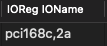

# Restore Atheros Wi-Fi on macOS Monterey through Tahoe

Apple removed native support for many older Atheros wireless adapters beginning with macOS Mojave. Restoring them on newer versions requires legacy drivers, and Monterey and later also require OCLP root patches.

Supported chipsets that had support dropped in Mojave, these include:

- AR242x
- AR542x
- AR5416
- AR5418
- AR9280 - AR5BHB92
- AR9285 - AR5B95
- AR9287 - AR5B97
- AR9380 - AR5BXB112
- AR946x* (AR9462 & AR9463)
- AR9485*
- AR9565*

<b>* Required Spoofing</b>

### 1. Install the wireless kernel extensions

Copy the following kexts to `EFI/OC/Kexts` and add enabled entries under `Kernel -> Add`.

| Kext | `MinKernel` | `MaxKernel` |
|---|---|---|
| `AMFIPass.kext` | `20.0.0` | |
| `corecaptureElCap.kext` | `18.0.0` | |
| `IO80211ElCap.kext` | `18.0.0` | |
| `IO80211ElCap.kext/Contents/PlugIns/AirPortAtheros40.kext` | `18.0.0` | `24.99.99` |
| `AirPortAtheros40-Tahoe.kext` | `25.0.0` | |

Downloads:

- [OCLP Wi-Fi payloads](https://github.com/dortania/OpenCore-Legacy-Patcher/tree/main/payloads/Kexts/Wifi)
- [OCLP Acidanthera payloads](https://github.com/dortania/OpenCore-Legacy-Patcher/tree/main/payloads/Kexts/Acidanthera)

**Important:** Use the correct driver for the macOS version:

- Monterey through Sequoia (Darwin 21–24): nested `AirPortAtheros40.kext`.
- Tahoe (Darwin 25): `AirPortAtheros40-Tahoe.kext`.

Both entries can remain in the OpenCore configuration when their kernel-version restrictions are correctly set.
In `IO80211ElCap.kext`, open `Contents/PlugIns` and remove other kexts but retain `AirPortAtheros40.kext`. Other Wi-Fi plug-ins are not needed for this Atheros-only configuration.

## 2. Configure PCI device properties 

Skip this section if your card does not require spoofing.

### 2.1 Identify the Wi-Fi adapter's PCI path

1. Open **Hackintool** and go to the **PCIe** tab.
2. Find the Atheros card.
3. Right-click the entry and select **Copy Device Path**.
4. Find or create that exact path under `DeviceProperties -> Add` in `config.plist`.

### 2.2 Choose a card to spoof

The following IDs are natively supported by `AirPortAtheros40`. 

| Driver family | `IOName` / `compatible` (String) | `device-id` (Data) | Reference |
| --- | --- | --- | --- |
| AR93xx | `pci168c,30` | `30000000` | Used by iMac12,x |
| AR928x | `pci168c,2a` | `2A000000` | Used by iMac11,x |
| Unknows | `pci106b,86` | `86000000` |  |
| AR242x / AR542x | `pci168c,1c` | `1C000000` | |
| AR5416 | `pci168c,23` | `23000000` | |
| AR5418 | `pci168c,24` | `24000000` | |

### 2.3 Add the injected properties

Under your adapter's `DeviceProperties -> Add` entry, set:

| Key*   | Value      |   Type | Description |
|--------|------------|--------|--------|
| IOName |  | String | Helps OpenCore Patcher detect, and enable **"Legacy Wireless"** option. |
| device-id |  | Data | For cards that needs spoofing <i>" "...due to AirPortAtheros40 having internal PCI ID checks meaning simply expanding the device-id list won't work."</i> [(Reference)](https://github.com/khronokernel/IO80211-Patches?tab=readme-ov-file#unsupported-atheros-chipsets) |
| compatible | | String | Advertises a compatible PCI device identity |

Examples:

- **AR9287:** An adapter reporting `pci168c,2e` may be spoofed to `pci168c,2a` with `device-id = 2A000000`.
- **AR9485:** An adapter reporting `pci168c,32` may be spoofed to `pci168c,30` with `device-id = 30000000`.

These properties must be applied to the actual Wi-Fi device, not merely to its parent PCI bridge.

## 3. Configure OpenCore security settings

Under `Misc -> Security`, set:

- Set Secure Boot Model to `Disabled`.
     - Changing the secure boot status requires an NVRAM reset, or variables retained can cause issues with IMG4 verification in macOS. [(Reference)](https://github.com/mrlimerunner/sonoma-wifi-hacks?tab=readme-ov-file#pre-root-patching)

## 4. Configure NVRAM and SIP

In `config.plist`, open:

`NVRAM -> Add -> 7C436110-AB2A-4BBB-A880-FE41995C9F82`

Add the following NVRAM parameters under `Add` and `Delete`:

| Key*   | Value      |   Type |
|--------|------------|--------|
| boot-args | amfi=0x80 ipc_control_port_options=0 | String |
| csr-active-config | 03080000 | Data | 

- `ipc_control_port_options=0`: workaround if you run into issues with Electron based apps after disabling SIP, ie: *Discord*, *Google Chrome*, *VS Code*.
- `amfi=0x80`: disables AMFI, required in order for OCLP to appply root patches.
-  `csr-active-config` of `03080000` sets SIP (System Integrity Protection) to a reduced state.

## 5. Apply OpenCore Legacy Patcher root patches

Apply OpenCore Legacy Patcher root patches. If **Legacy Wireless** is missing, check the troubleshooting section before applying unrelated patch sets. On unsupported Hackintosh hardware, OCLP's model detection may not behave exactly as it does on an actual Mac.

## 6. Troubleshooting

### Wi-Fi appears, but the network will not connect

Try manually joining the network with **Other…** in the Wi-Fi menu or adding it through **System Settings -> Network**. Forgetting and rejoining the network may also help.

### OCLP does not offer “Legacy Wireless”

Check if your injected PCI path matches the actual adapter, and any required `IOName`, `compatible`, and `device-id` values appear in IORegistry.

If device properties are not being applied and your wireless device lacks an ACPI name, the optional SSDT workaround below may help. **A missing Legacy Wireless option alone does not prove an ACPI naming problem.**

## 7. Advanced: create an ACPI device name (optional)

Use this only if the Wi-Fi adapter's **device properties are not taking effect** and you have confirmed that its PCI function does not already have a suitable named ACPI device. Do not add a second ACPI device with the same address if one already exists.

### 7.1 Inspect the device path

In Hackintool's PCIe tab, locate your adapter and inspect its hierarchy. For example:

```text
PCI0 @0 / RP04 @1C,3 / pci168c,36 @0
```


In this example:

- `PCI0.RP04` is the **parent PCI bridge's ACPI path**.
- `@0` at the end is the **Wi-Fi endpoint's PCI device/function address**.
- `pci168c,36` is the name shown for the unnamed endpoint, not a four-character ACPI device name.

A named endpoint may appear as `ARPT` (or another four-character ACPI name):


### 7.2 Create an SSDT

Create a source file named `SSDT-ARPT.dsl`:

```asl
DefinitionBlock ("", "SSDT", 2, "ARPT", "WIFIPCI", 0x00000000)
{
    External (\_SB_.PCI0.RP04, DeviceObj)

    Scope (\_SB_.PCI0.RP04)
    {
        Device (ARPT)
        {
            Name (_ADR, 0x00000000)
        }
    }
}
```

Replace `PCI0.RP04` with your adapter's **actual parent ACPI bridge path**, and change `_ADR` to match your **Wi-Fi endpoint's PCI device and function**.

**How `_ADR` works:** PCI device numbers occupy the upper 16 bits and function numbers occupy the lower 16 bits:

```text
_ADR = (PCI device number << 16) | PCI function number

Pci(0x0,0x0) → 0x00000000
Pci(0x2,0x0) → 0x00020000
Pci(0x1C,0x3) → 0x001C0003
```

Compile the DSL into `SSDT-ARPT.aml` using MaciASL or `iasl`. Then:

1. Copy `SSDT-ARPT.aml` to `EFI/OC/ACPI`.
2. Add and enable the file under `ACPI -> Add` in `config.plist`.
3. Save the EFI configuration and reboot.
4. Inspect the adapter in Hackintool or IORegistryExplorer again.

Expected display for this example:

```text
Before: PCI0 @0 / RP04 @1C,3 / pci168c,36 @0
After:  PCI0 @0 / RP04 @1C,3 / ARPT @0
```

| Before | After |
| --- | --- |
|  |  |

Once the injected properties are confirmed, open OCLP again and check whether **Legacy Wireless** becomes available. Apply the root patch if offered.

# Restore Atheros Bluetooth on macOS Monterey through Tahoe

### 1. Install the Bluetooth kernel extensions

Copy these kernel extensions into `EFI/OC/Kexts` and add enabled entries under `Kernel -> Add` in `config.plist`.

| Kext | `MinKernel` | Source |
|---|---|---|
| `BlueToolFixup.kext` | `21.0.0` | [Link](https://github.com/enigma131/BrcmPatchRAM) |
| `Ath3kBT.kext` | | [Link](https://github.com/zxystd/AthBluetoothFirmware/releases/tag/v1.1.0) |

This is a **modified BlueToolFixup from enigma131's fork**, do not use the upstream build. The modified version includes additional patches for Atheros Bluetooth controllers.

**Do not use `Ath3kBTInjector.kext` on Monterey or later.** If you are dual booting Big Sur or earlier, set its maxKernel to `20.99.99`.

### 2. Enable Atheros Bluetooth patches

In `config.plist`, open:

`NVRAM -> Add -> 7C436110-AB2A-4BBB-A880-FE41995C9F82`

Append the following argument to your existing `boot-args`:

```
-btlfxath
```

This enables enigma131's additional Atheros Bluetooth compatibility patches.

Preserve any existing boot arguments needed by your hardware.

### 3. Verify the Bluetooth USB device ID

Some Atheros Bluetooth controllers require their USB vendor and product IDs to be present in:

`Ath3kBT.kext/Contents/Info.plist`

Inspect the `IOKitPersonalities` section and verify that your controller is supported.


## Credits and references

- [MrLimeRunner – sonoma-wifi-hacks](https://github.com/mrlimerunner/sonoma-wifi-hacks) — OpenCore and root-patching configuration guidance.
- [PG7 on InsanelyMac](https://www.insanelymac.com/forum/topic/359007-wifi-atheros-monterey-ventura-sonoma-work/) — Atheros restoration approach.
- [Dortania – OpenCore Legacy Patcher](https://github.com/dortania/OpenCore-Legacy-Patcher) — Wi-Fi payloads, root patches, and AMFIPass by DhinakG.
- [khronokernel – IO80211-Patches](https://github.com/khronokernel/IO80211-Patches) — Legacy Atheros PCI IDs and spoofing notes.
- [ACPI Specification](https://uefi.org/sites/default/files/resources/ACPI_Spec_6_5_Aug29.pdf) — PCI `_ADR` device/function encoding.
- [enigma131 – BrcmPatchRAM](https://github.com/enigma131/BrcmPatchRAM) — Modified BlueToolFixup with Atheros Bluetooth support.
- [zxystd – AthBluetoothFirmware](https://github.com/zxystd/AthBluetoothFirmware) — Atheros Bluetooth firmware uploader.
